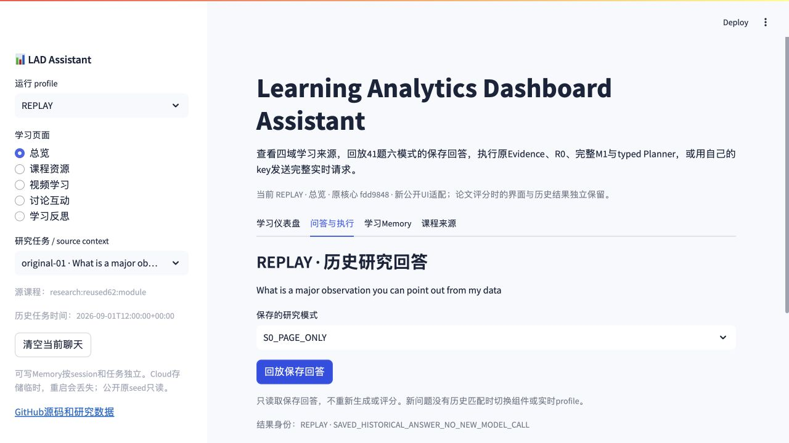
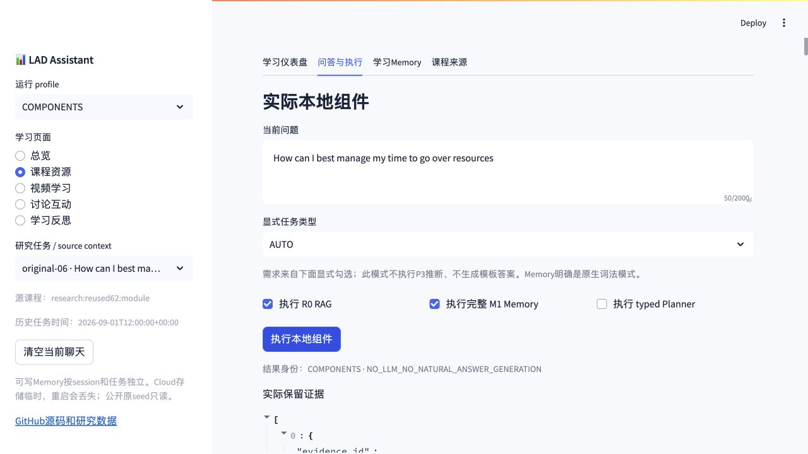

# Learning Analytics Dashboard Assistant · LAD

学习分析仪表盘助手：浏览已授权的匿名学习数据，回放真实研究回答，执行原研究组件，并可使用访客自己的 key 进行实时问答。发布日期：2026-10-10。

[代码与研究材料地图](docs/PROJECT_MAP.md) · [来源及变换](docs/RECOVERY.md) · [架构](docs/ARCHITECTURE_G0_R1.md) · [实际测试](docs/VALIDATION_G0_R1.md) · [研究入口](research/README.md) · [许可说明](docs/LICENSING_G0_R1.md)





这些截图来自本轮实际本地浏览器。Community Cloud登录与GitHub OAuth已完成，目标仓库/main/app.py已填写；浏览器工具尚无法提交Python下拉选择，需要作者在Advanced settings选择3.13并Save。尚没有经过验证的云应用地址。原GitHub Pages只是历史静态导览。

## 安装和启动

使用 **Python 3.13**；本轮实测版本为3.13.0。默认安装无需模型下载或API key。

```bash
git clone https://github.com/mingliu0408-design/learning-analytics-dashboard-assistant.git
cd learning-analytics-dashboard-assistant
python3.13 -m venv .venv
source .venv/bin/activate
python -m pip install -r requirements.txt
python -m pip check
python -m streamlit run app.py --browser.gatherUsageStats=false
```

Windows激活：`.venv\Scripts\activate`。从项目根目录启动，打开终端给出的localhost地址。完整锁定环境见`requirements-lock.txt`。Dockerfile使用Python3.13；Docker构建未在本轮实测。

## 五页和三种profile

Overview（四域汇总）、Resources、Lecture、Debate、Reflection共五页。Overview不新增第五域事件。每个任务显示真实课程、时间和来源身份；人工控制研究条件保持其标签。`Total_chars`是字符编辑量，unknown保持unknown；活动记录不证明理解或学习效果。

| Profile | 实际行为 | 资源及边界 |
|---|---|---|
| REPLAY | 读取41任务×6模式的246个保存回答，179个不同回答文本 | 无key；保留历史身份与回答hash，不生成新问题答案 |
| COMPONENTS | 原Evidence、单需求门控R0、完整M1、typed Planner输入与检查 | 无key；需求来自访客显式勾选，不冒称P3；Memory明确词法模式；没有LLM候选时不编造自然语言答案 |
| LIVE | 原FrozenP3三个专项角色→R0/完整M1→P1+i5 candidate及单次修复→FINAL与引用检查 | 访客自备key；Memory需求需要固定MPNet及可选依赖；缺失资源明确失败。本轮仅精确mock验证，未进行真实付费推理 |

建议：先点击“问答与执行→回放保存回答”，再切换COMPONENTS执行R0/Memory查看实际来源与轨迹；需要时在“学习Memory”明确保存或更正自己的学习信息。

实时调用只在点击发送时发生。问题、当前可见聊天与启用的学习/课程/Memory内容会发送至OpenAI，费用由访客账号承担。key仅保留在该session内存，不写环境、日志、数据库或公共缓存。Gold与评分参考公开于独立评价区，禁止进入生成输入或RAG。

## 完整研究数据

小型运行数据已经在`data/`，clone即可回放。完整学习原文件发布副本、课程、历史/Memory、最终41、匿名评分、40锚点、S7/R7/D9及实际W9论文和补充材料通过本仓库新Release资产发布。[v0.2.0-g0-r1数据资产](https://github.com/mingliu0408-design/learning-analytics-dashboard-assistant/releases/download/v0.2.0-g0-r1/LAD_ASSISTANT_G0_R1_RESEARCH_DATA_2026-10-10.zip)已上传，并通过匿名公开下载、整包及逐成员哈希回读。大小67,328,343字节，17,704成员，SHA-256 `cb690dc0adbf361ea437a72e8beae319fdee3ca25b5311403cb497ffc7843612`。完整机器记录见`data/manifest.json`。

```bash
python scripts/download_research_data.py --destination research/released_data
```

下载脚本无需GitHub认证，校验SHA、CRC、每文件hash及安全路径，拒绝重复/穿越/符号链接/异常大小或覆盖不同的已有文件；重复运行不写相同文件。发布副本保留匿名关系、时间、原回答和评分；移除身份和认证信息，变换及前后hash有明确记录。原研究文件与论文未修改。

最终246身份与legacy62×9、DEV历史版本分开。八个未运行原题没有新增回答；183个继承slot的内部完整checkpoint及八次历史unknown completion仍缺少完整证据，不根据均值或后续回答补造。找回的真实RQ1 final128 CSV与冻结记录hash一致，位于`research/data/evaluation/rq1/`。

## 可选完整实时资源

```bash
python -m pip install -r requirements-live.txt
python scripts/download_model.py
export LAD_MPNET_PATH="$PWD/.local/models/e8c3b32edf5434bc2275fc9bab85f82640a19130"
python -m streamlit run app.py --browser.gatherUsageStats=false
```

MPNet身份为`sentence-transformers/all-mpnet-base-v2`，固定revision和三个原始文件hash由获取脚本校验。模型依赖与真实provider推理未在本轮实测；默认Cloud不会自动下载该模型。被冻结的P3 provider模型身份由代码保留，服务的未来可用性由provider决定。

完整M1读取及其断网保护依赖全部在无provider凭据worker里导入；主UI/API进程保留正常网络调用。只读原seed按session和任务复制到独立可写SQLite，聊天也按task/session隔离。默认目录为系统临时目录；Community Cloud重启可能丢失。设置`LAD_SESSION_STORAGE=/path`可使用本地持久目录，但重开同一记忆还需保留同一session ID；没有登录、跨设备同步或永久云数据库。

## 实际验证与代码入口

```bash
python -m unittest discover -s tests -v
python scripts/security_scan.py --repo .
cd research
python -m unittest discover -s checks -p 'test_*.py' -v
python checks/check_snapshot.py
python checks/check_rq3.py
```

本轮48项应用测试、20项研究测试、7项RQ3契约及315文件原快照哈希检查通过。AppTest覆盖五页/回放/实际组件/完整UI到核心mock/两个session；localhost HTTP mock在完整M1读取前后完成5个provider POST。CI在Ubuntu/Python3.13无需key运行同套检查，实际run结果另记发布记录。这些检查没有重跑研究回答、重评或修改统计。

```text
app.py                          # 五页公开入口
public_runtime/core.py          # session隔离、回放、显式provider调用
research/src/rq3_original/public_core_worker.py  # 完整原研究核心隔离worker
data/course/, data/replay/       # 实际课程和历史输入/回答/只读Memory seeds
data/dashboard/                 # 匿名学习源副本
research/data/evaluation/       # 独立Gold与参考，不进入应用生成
research/src/rq1_original/, rq2_original/, rq3_original/ # 恢复的研究代码
scripts/download_research_data.py, download_model.py, security_scan.py
tests/                          # 无key集成/正负/隔离测试
```

## 研究、许可和限制

246表示回答条件，不是246名学生、独立问题或不同文本。历史研究数值及方法限制保留在`research/`；新公开UI不能追称为论文评分时已经运行的界面。原版权与第三方NOTICE保留，本轮没有统一赋予MIT/CC0。公开授权不改第三方权利；文件没有明确复用许可时应联系权利人。见[本次许可补充](docs/LICENSING_G0_R1.md)。

完整实时质量、可选MPNet安装、Docker构建、生产并发及永久托管不由本轮mock验证建立。云部署与代码/数据发布分别报告。

---

## English

This restored public LAD application provides five views: Overview, Resources, Lecture, Debate and Reflection. Its three profiles are explicit: **REPLAY** reads 246 saved answer identities from 41 tasks and six modes; **COMPONENTS** executes the original scoped Evidence, single-gated lexical R0, isolated complete M1 and typed planning checks without a model; **LIVE** connects the original three-role FrozenP3, source modules, P1/i5 candidate/repair and FINAL/citation checks using the visitor's key.

Use Python3.13 and the installation commands above from the repository root. The included small real, anonymized datasets allow no-key startup; obtain the full research archive with `python scripts/download_research_data.py`. Download identity and public availability are recorded in `data/manifest.json`. The downloader validates archive and member hashes and refuses unsafe paths or changes to existing user files.

API keys, chat histories and writable Memory are session-specific. Full M1 is imported only in a credential-free child process; evaluation Gold never enters generation or retrieval. Optional Hybrid Memory requires the pinned MPNet resource; missing resources cause an explicit error. Community Cloud storage is temporary. The current live integration was tested with exact request/response and localhost HTTP mocks, with no paid inference and no regenerated research answers or ratings.

The original files, frozen results, notices and licensing boundaries are preserved. Publication copies record identity/path/authentication transformations. Latest W9 manuscript and supplement, ratings, anchors, analyses and separate historical datasets are included in the Release archive. Missing historical execution checkpoints remain unknown. The public adaptation does not establish real-student learning outcomes, production scale or ownership beyond documented contributions.
