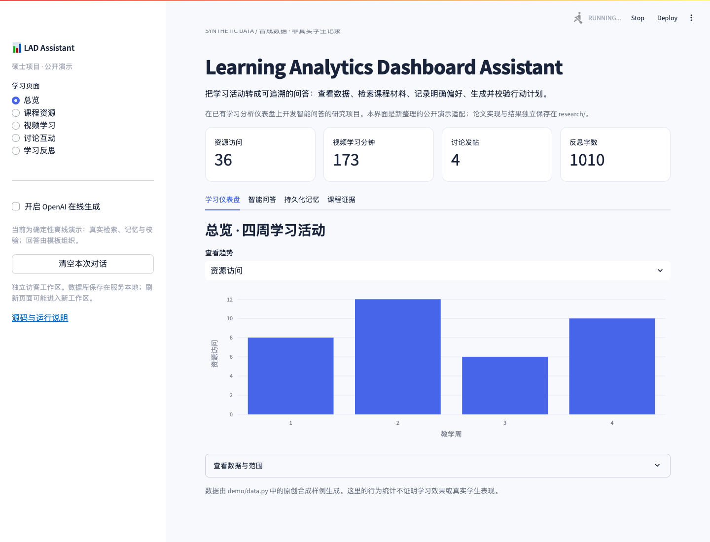

# Learning Analytics Dashboard Assistant

**学习分析仪表盘智能问答助手 · 硕士毕业项目的公开技术演示**

在已有学习分析仪表盘上研究并集成智能问答：从页面数据组织证据，按问题启用课程检索、学习者记忆与计划模块，并展示回答引用和执行轨迹。

**[浏览器导览](https://mingliu0408-design.github.io/learning-analytics-dashboard-assistant/)** · [项目架构](docs/ARCHITECTURE.md) · [代码来源与贡献边界](docs/PROVENANCE.md) · [研究代码与结果](research/README.md)



导览页展示公开合成数据和预生成示例，适合快速参观。完整 Streamlit 应用可按下面的命令在本地运行；默认无需 API Key，真实执行检索、SQLite 记忆和约束校验，使用确定性模板组织回答。在线生成是可选项。

## 三分钟运行

需要 Python 3.12。首次安装依赖需要网络；默认离线问答不访问外部服务。

```bash
git clone https://github.com/mingliu0408-design/learning-analytics-dashboard-assistant.git
cd learning-analytics-dashboard-assistant
python3 -m venv .venv
source .venv/bin/activate          # Windows: .venv\Scripts\activate
python -m pip install -r requirements.txt
streamlit run app.py
```

打开终端显示的本地地址，通常是 `http://localhost:8501`。

本次验证使用干净的 Python 3.12.14 环境。`requirements-lock.txt` 另外保存完整依赖版本，供排查环境差异；不要使用宿主旧 Anaconda 环境代替新的虚拟环境。

也可使用 Docker：

```bash
docker build -t lad-assistant-demo .
docker run --rm -p 8501:8501 -v lad-memory:/home/demo/.lad-demo lad-assistant-demo
```

Dockerfile 是提供的运行方式；是否已实际构建，以 [本次验证记录](docs/VALIDATION.md) 为准。

## 建议体验顺序

1. 在总览查看四周合成学习活动，切换课程资源、视频、讨论与反思页面。
2. 点击示例问题，查看回答引用、启用能力和执行轨迹。
3. 到“持久化记忆”明确保存学习目标或约束，再问与这条信息有关的问题；更新记录可查看版本替代。
4. 请求一个行动计划，打开结构化计划与约束检查结果。
5. 如需自由生成，手动开启 OpenAI 模式并填写**自己的** API Key，再发送问题。

在线调用将问题、当前可见历史与所选证据提交给 OpenAI，费用由使用者承担。默认关闭；本项目不提供共享 Key，Key 不写入数据库。公开站点不运行模型服务。

## 可以查看和运行什么

| 能力 | 公开演示路径 | 研究版本边界 |
| --- | --- | --- |
| 仪表盘 | 新 Streamlit 展示适配、Pandas/Plotly、原创合成活动数据 | 原仪表盘是已有基线；不声称全部从零原创 |
| 课程 RAG | 复用原 R0 加权词法评分、显式注入合成课程片段、显示引用 | 不是向量检索；演示语料不是论文的 6 文档/624 块 |
| 持久化记忆 | 复用原 SQLite + FTS5、明确写入、来源记录、更新替代与范围隔离 | 论文使用预先构造的记忆状态；未证明真实学生对话自动学习 |
| 规划 | 演示候选计划接入原已编码约束检查 | 格式、引用及约束检查不保证建议语义正确 |
| 路由与生成 | 演示规则路由；离线模板或可选 OpenAI 生成 | 原 P3 的三个专项判断与 MPNet 实验没有作为默认每次请求的模块 |
| 研究复现 | `research/` 保留已公开的实现、配置、匿名数值输入和离线检查 | 数值重算与合成检查不等于重跑原训练、模型回答或人工评分 |

本次公开包装新增界面、合成数据和运行适配。**不能把这些新增内容作为论文原实验已经完成的功能或结果。**

## 看代码

```text
app.py                         # 可运行的 Streamlit 页面
demo/core.py                   # 问答编排、原模块适配与可选模型调用
demo/data.py                   # 原创合成数据和课程材料
tests/test_demo.py             # 不调用真实模型的公开演示检查
docs/                         # HR 导览、架构、来源、验证记录
research/                     # 已公开的研究复现快照，保持独立
  src/rq3_original/            # R0、SQLite Memory、作用域与规划检查
  src/rq1_original/            # 意图排序实验实现
  src/rq2_original/            # 能力路由实验实现
```

```bash
python -m unittest discover -s tests -v
python research/checks/check_snapshot.py
python research/checks/check_rq3.py
```

研究数值重算有独立的 NumPy 环境要求，按 [research/README.md](research/README.md) 执行，不与演示依赖混装。

## 研究结果应怎样理解

研究快照记录了 RQ2 P3 能力路由 Macro-F1 约 **0.931**：核心分母为 32 条 ANSWER，完整 TEST 为 36 条。同一 TEST 用于最终选型，结果属于选型条件下的评估，不是独立选型后的验证。

RQ3 有 17 个保留问题及 12 个能力家族中的 24 个条件，共 41 个任务/条件，在六种配置下形成 246 个回答条件。它们不是 246 名用户、246 个独立问题或 246 段不同文本；不能据此声称真实学生学习成效。具体输入、指标定义与限制见 [研究复现说明](research/REPRODUCIBILITY.md)。这些数字不用于评估本次演示适配。

## 数据、许可和运行边界

- 仪表盘与课程演示数据全部为合成内容；不包含真实学生记录、真实会话、受限课程文档或模型权重。
- `.local/` 的访客记忆数据库与 `.streamlit/secrets.toml` 已被排除。共享部署时每个浏览器会话使用独立工作区；刷新后可能进入新工作区。后端数据库可重新打开，但本界面未提供登录或跨设备账号同步。
- 这是本地可运行的公开原型；不声称生产部署、高并发、安全认证或建议正确性保证。
- 原研究快照没有新增统一开源许可。公开可阅读和按说明体验，不代表获得整个历史工程的 MIT/CC0 授权。保留 [research/LICENSING.md](research/LICENSING.md) 和 [第三方说明](research/THIRD_PARTY_NOTICES.md)。

---

**English:** A runnable public demonstration of a modular learning analytics assistant developed on an existing dashboard baseline. It reuses real lexical retrieval, SQLite learner-memory and encoded planning checks with synthetic inputs. Default answers are deterministic; optional OpenAI generation requires the visitor's own key. The separate `research/` snapshot preserves implementation and saved-material reproducibility, with explicit limits on authorship, data access and experimental claims.
