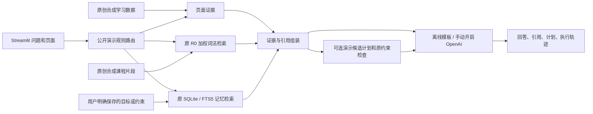

# 演示架构

`app.py` 接收页面与问题，调用 `demo.core.DemoAssistant.answer`。助手绑定固定的合成学习者/课程范围，按演示规则决定需要的模块，调用原研究实现的检索与记忆，并将引用随答案显示。记忆写入只通过显式表单调用；对话历史保存在当前 Streamlit 会话，不等于跨会话数据库。

图表展示来自结构化学习活动与 Plotly，不使用截图、视觉识别或多模态理解。原 R0 是词法评分；SQLite 是关系存储，FTS5 是全文检索，都不写成向量数据库。

为适配中文演示，查询使用显式中英文词汇扩展；中文目标/约束等关键词也可触发同范围、同类型的 SQL 读取补充，轨迹标明 `NEW_DEMO_EXPLICIT_TYPE_LOOKUP`。这是新的公开适配，不是原 FTS5 的语义检索能力或 MPNet 推理。

在线生成在使用者选择并发送问题后执行，默认不启动。错误不会被描述成正常模型回答。原规划检查覆盖已编码结构和约束，语义正确性未检查。

可选在线路径使用 OpenAI Chat Completions `gpt-4o-mini`、非流式 `strict JSON Schema`，输出 `answer` 与 `cited_evidence_ids`；客户端检查合法引用、去重及内联引用一致性。格式/ID 不合格时最多纠错一次；传输超时 20 秒、SDK 自动重试关闭。失败返回明确标注的离线证据示例，界面不提交成功对话历史。接口依据见 [OpenAI Structured Outputs](https://developers.openai.com/api/docs/guides/structured-outputs?api-mode=chat)。这不构成语义正确性验证；本次没有真实模型调用。

研究版本的冻结 P3、路由对照、MPNet 和六种 RQ3 配置见 `research/docs/`；默认演示没有运行这些模型实验。无需模型权重或原课程语料即可体验演示，不意味着完整论文训练和评估能够在当前输入上复现。
