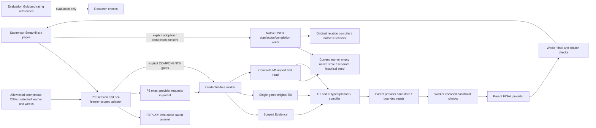

# Restored public application architecture

The main API/UI process never imports original M1 or its network-denial guard. All core source/Memory work is isolated in the child; parent provider SDK receives an explicit in-memory visitor key. Worker environment uses an allowlist and no provider credentials. A real localhost HTTP fixture checked three P3 calls, candidate and FINAL across the complete M1 boundary.

REPLAY does not generate and carries its own historical identity separate from the displayed learner. COMPONENTS demand comes from explicit checkboxes, uses selected LEXICAL or configured HYBRID Memory and has no P3 inference or natural-language model answer. LIVE preserves the original clarification and S0/S1 bypasses, exact frozen role payloads and complete source service. Optional Hybrid resources are required when the P3 Memory bit is true; no silent lexical replacement is labelled Hybrid. Encoded plan and permitted-reference checks are preserved, with no semantic-quality or answer-plan-fidelity guarantee.

Each visitor owns separate key/history/workspace. Current dashboard learners start with empty native stores; only historical tasks copy their corresponding immutable research seed. Original SQLite, graph and source events stay read-only. Corrective writes preserve USER role, consent, source events, links and supersession. A checked proposal is registered outside Memory; only explicit consent adopts it as a USER plan and accepted native actions. A subsequent explicit completion self-report links to that accepted native action and plan through the original relation compiler. Writes stage the native store before checking policy and relations; this serial session adapter does not claim cross-process atomic multi-file transactions. Public evaluation data is a separate sidecar and source ingestion rejects Gold fields. RQ1 ranking and RQ2 comparisons remain separate research entrypoints.
