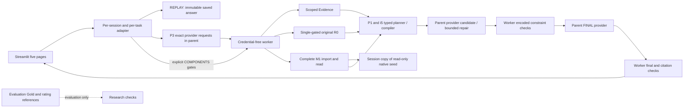

# Restored public application architecture

The main API/UI process never imports original M1 or its network-denial guard. All core source/Memory work is isolated in the child; parent provider SDK receives an explicit in-memory visitor key. Worker environment uses an allowlist and no provider credentials. A real localhost HTTP fixture checked three P3 calls, candidate and FINAL across the complete M1 boundary.

REPLAY does not generate. COMPONENTS demand comes from explicit checkboxes, uses lexical Memory and has no P3 inference or natural-language model answer. LIVE uses the exact original frozen role payloads and complete source service. Optional Hybrid resources are required when the P3 Memory bit is true; no silent lexical replacement is labelled Hybrid. Encoded plan and permitted-reference checks are preserved, with no semantic-quality guarantee.

Each visitor owns separate key/history/workspace. Every task's native seed is copied into that workspace before writing, and original SQLite, graph and source events stay read-only. Corrective writes preserve USER role, consent, source events, links and supersession. Public evaluation data is a separate sidecar and source ingestion rejects Gold fields.
